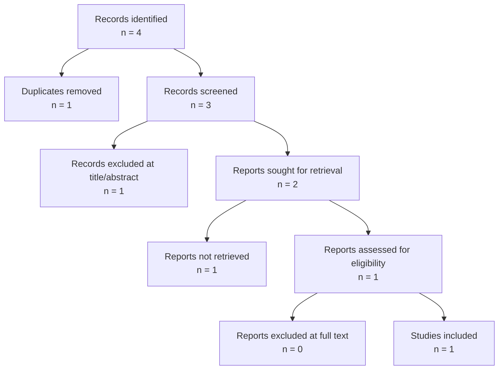

# PRISMA 2020 流程图数据

> 由候选级筛选记录生成；标准为 PRISMA 2020。计数可复核，但不构成 PRISMA 合规声明。
> 项目：rs-a874c2ae ｜ 生成时间：2026-11-18T18:00:27.622Z ｜ 完整：是 ｜ 数据一致：是

## 流量计数

| 阶段 | 计数 |
| --- | --- |
| 识别记录 | 4 |
| 移除重复 | 1 |
| 去重后记录 | 3 |
| 标题/摘要已筛 | 3 |
| 标题/摘要排除 | 1 |
| 寻求全文 | 2 |
| 全文不可得 | 1 |
| 全文评估 | 1 |
| 全文排除 | 0 |
| 纳入研究 | 1 |
| 待处理 | 0 |

## 三阶段决策

| 阶段 | 已决策 | include | exclude | maybe | 未决策 |
| --- | --- | --- | --- | --- | --- |
| 标题 | 3 | 3 | 0 | 0 | 0 |
| 摘要 | 3 | 2 | 1 | 0 | 0 |
| 全文 | 2 | 1 | 1 | 0 | 0 |

## 排除理由

| 阶段 | 代码 | 理由 | 计数 |
| --- | --- | --- | --- |
| 摘要 | wrong-outcome | 结局不符 | 1 |
| 全文 | not-retrieved | 全文不可得 | 1 |

## Mermaid 流程图

## 候选明细

| ID | 标题 | 重复 | 标题 | 摘要 | 全文 | 来源 |
| --- | --- | --- | --- | --- | --- | --- |
| R-0001 | From Black Box to Audit Trail: Implementing Explainable Agentic AI and Human-in- | 否 | include | include | include | S-0001 |
| R-0002 | Agentic Workflows for Economic Research: Design, Implementation, and Evaluation | 否 | include | exclude (wrong-outcome) | — | S-0002 |
| R-0003 | Auditing an AI-Agent Computational Drug-Discovery Workflow Through an SMPD1 Case | 否 | include | include | exclude (not-retrieved) | S-0003 |
| R-0004 | From Black Box to Audit Trail: Implementing Explainable Agentic AI and Human-in- | → R-0001 | — | — | — | S-0001 |

