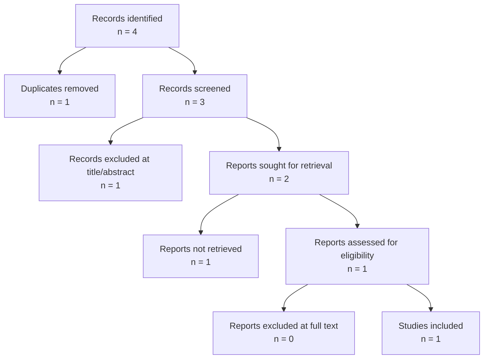

# 0.11 宿主循环验收：真实题录与两次暂停

> 研究包由科研套件（dsh-research-suite）生成。阶段：**假设** ｜ 档位 **S** ｜ 事件 35 条。

## 0. 状态

| 字段 | 值 |
| --- | --- |
| Campaign | rs-a874c2ae |
| 阶段 | 假设 (hypothesis) |
| 档位 | S · 60000 tokens 预算 |
| 模板 | 空白 |
| 领域 | 通用流程 |
| 闭环成熟度 | 未评估 |
| 创建 / 更新 | 2026-11-17T21:13:35.627Z / 2026-11-18T17:26:12.259Z |
| 事件链 | 完整（35 条） |
| 工件 | 8 个 |

## 1. 研究问题与边界

**问题**：真实宿主的 loop 能否在缺输入时暂停、补齐后恢复，并在真实题录登记后再次停在输入检查点？

**边界**：只使用本机 DSH 事件链、真实 OpenAlex/Crossref 题录与本地脚本；不调用模型、不自动批准、不把候选标题当成已验证证据。

**成功判据**：至少两轮真实行动、一次成功恢复、一次新的输入暂停；题录来自真实检索，事件链完整且无自动批准。

## 2. 世界模型

| 类别 | 键 | 值 |
| --- | --- | --- |
| question | main | 真实宿主的 loop 能否在缺输入时暂停、补齐后恢复，并在真实题录登记后再次停在输入检查点？ |
| coverage | human-oversight | S-0001, S-0002, S-0007, S-0008 覆盖人工检查点与可审计治理 |
| coverage | checkpoint-recovery | S-0004, S-0005, S-0006 覆盖长运行状态、检查点与恢复 |

## 3. 来源

| ID | 标题 | 年份 | 类型 | 可信度 | DOI / URL | 内容哈希 |
| --- | --- | --- | --- | --- | --- | --- |
| S-0001 | From Black Box to Audit Trail: Implementing Explainable Agentic AI and Human-in-the-Loop Governance for High-Risk Enterprise Decisions | 2025 | paper | primary | 10.55041/ijsrem53440 | sha256:7958d… |
| S-0002 | Agentic Workflows for Economic Research: Design, Implementation, and Evaluation | 2025 | preprint | primary | 10.48550/arxiv.2504.09736 | sha256:00a59… |
| S-0003 | Auditing an AI-Agent Computational Drug-Discovery Workflow Through an SMPD1 Case Study | 2026 | preprint | primary | 10.21203/rs.3.rs-11093091/v1 | sha256:db64e… |
| S-0004 | Graph-Based Agentic AI with LangGraph: Workflow Pathways for Long-Running Stateful Business Processes | 2026 | preprint | primary | 10.48550/arxiv.2607.19297 | sha256:56b55… |
| S-0005 | BioAgent: An Auditable Multi-Agent Framework for Reproducible Translational Bioinformatics | 2026 | preprint | primary | 10.21203/rs.3.rs-9535691/v1 | sha256:28906… |
| S-0006 | Closing the Empirical Loop: Autonomous AI Agents Conduct End-to-end Research With Human Participants | 2026 | paper | primary | 10.1002/advs.76675 | sha256:9d7ae… |
| S-0007 | Systematic Literature Reviews With Two Multi-Agentic Systems And Human-In-The-Loop | 2026 | preprint | primary | 10.48550/arxiv.2607.21920 | sha256:96789… |
| S-0008 | pAI-Econ-claude: A Gated Human-in-the-Loop Multi-Agent Architecture for AI-Assisted Economic Theory Development | 2026 | preprint | primary | 10.48550/arxiv.2607.21268 | sha256:f6cc8… |

## 3.1 检索协议

检索记录 3 条（否证 2）· 命中/初筛/纳入 39/31/8。检索在外部执行，本表只登记可复核的查询与筛选计数。

| ID | 类型 | 数据库 | 查询 | 日期范围 | 命中 | 初筛 | 纳入 |
| --- | --- | --- | --- | --- | --- | --- | --- |
| Q-0001 | database | OpenAlex + Crossref | human-in-the-loop agent checkpoint audit trail research workflow | 2023-01-01 – 2026-12-31 | 16 | 8 | 8 |
| Q-0002 | disconfirming | OpenAlex | autonomous agent loop skip human checkpoint null result | 2023-01-01 – 2026-12-31 | 3 | 3 | 0 |
| Q-0003 | disconfirming | OpenAlex + Crossref | autonomous agent loop skip human checkpoint null result | 2023-01-01 – 2026-12-31 | 20 | 20 | 0 |

## 3.2 研究计划与视角

目标：未填写。计划 0 个问题、0 个视角、2 条行动循环。

| 自治项 | 值 |
| --- | --- |
| 最大循环 | 5 |
| 停止条件 | 完成两轮真实行动并在下一个未补齐的输入检查点处停下，不放宽预算或完整性。 |
| 升级条件 | 出现未映射检查、完整性失败或人工检查点时升级给人类。 |
| 人类检查点 | 人工批准前必须由人核对证据；本轮不自动批准。 |

## 4. 断言与证据

| ID | 类型 | 断言 | 状态 | 置信度 | 证据 |
| --- | --- | --- | --- | --- | --- |
| — | — | — | — | — | — |

## 4.1 敏感性分析

换一种合理设定后结论是否仍成立。方向只描述本次分析，不是对真实效应的裁决。

| ID | 名称 | 方法 | 设定 | 结果 | 方向 | 追溯 |
| --- | --- | --- | --- | --- | --- | --- |
| — | — | — | — | — | — | — |

## 4.2 假设锦标赛、质量评分与矛盾台账

锦标赛是记录下来的两两判断，Elo 只反映这些判断的顺序，不证明胜者真实。

## 5. 数字台账

| ID | 名称 | 值 | 单位 | 不确定性 | 溯源 | 校验 |
| --- | --- | --- | --- | --- | --- | --- |
| — | — | — | — | — | — | — |

## 6. 运行

| ID | 阶段 | 状态 | 种子 | 对照 | 指标 | 命令 |
| --- | --- | --- | --- | --- | --- | --- |
| — | — | — | — | — | — | — |

## 7. 图

| ID | 标题 | 工件 | 代码 | 数据 | 环境 | 说明 |
| --- | --- | --- | --- | --- | --- | --- |
| — | — | — | — | — | — | — |

## 8. 评审

| ID | 评审人 | 角色 | 独立 | 机构 / 利益冲突 | 对抗 | 结论 | 阻断问题 |
| --- | --- | --- | --- | --- | --- | --- | --- |
| — | — | — | — | — | — | — | — |

## 9. 闸门历史

| 阶段 | 最近结果 | 通过 / 总项 | 阻断项 | 时间 |
| --- | --- | --- | --- | --- |
| 定题 | pass | 5/5 |  | 2026-11-17T21:13:48.497Z |
| 文献测绘 | pass | 9/9 |  | 2026-11-17T21:14:42.799Z |
| 假设 | 未运行 | — | — | — |
| 设计 | 未运行 | — | — | — |
| 执行 | 未运行 | — | — | — |
| 分析 | 未运行 | — | — | — |
| 写作 | 未运行 | — | — | — |
| 评审 | 未运行 | — | — | — |
| 发布 | 未运行 | — | — | — |

## 10. 预算

| 字段 | 值 |
| --- | --- |
| 档位 | S（建议 agents ≤ 1） |
| tokens | 0 / 60000 |
| 时长（秒） | 0 / 1800 |
| 超限 | 无 |

## 11. 复现命令

—

事件链与工件校验：

```bash
# 事件链（SHA-256，前一条的 hash 进入下一条）
sha256sum ledger.jsonl
```

## 12. 声明

尚未生成 AI 使用声明（`rsx_write action:"declaration"`）。

## 13. 当前阻断与下一步

当前阶段 **假设** 被阻断：

- `hypothesis`：add a claim with kind:"hypothesis"

## 14. 最近事件

| seq | 时间 | 类型 | actor |
| --- | --- | --- | --- |
| 24 | 2026-11-17T21:16:15.810Z | search.logged | agent |
| 25 | 2026-11-17T22:15:38.051Z | search.annotated | agent |
| 26 | 2026-11-18T16:14:10.388Z | report.rendered | agent |
| 27 | 2026-11-18T17:26:12.084Z | screening.decided | agent |
| 28 | 2026-11-18T17:26:12.115Z | screening.decided | agent |
| 29 | 2026-11-18T17:26:12.134Z | screening.decided | agent |
| 30 | 2026-11-18T17:26:12.159Z | screening.decided | agent |
| 31 | 2026-11-18T17:26:12.177Z | screening.decided | agent |
| 32 | 2026-11-18T17:26:12.197Z | screening.decided | agent |
| 33 | 2026-11-18T17:26:12.216Z | screening.decided | agent |
| 34 | 2026-11-18T17:26:12.234Z | screening.decided | agent |
| 35 | 2026-11-18T17:26:12.255Z | screening.duplicate | agent |

## 15. 自动化审查

尚未运行自动化审查。调用 `rsx_review action:"audit"`。


## 16. 证据抽取矩阵

- 维度：0 · 来源：8 · 已覆盖：0

尚未记录抽取维度。用 `rsx_extract action:"add"` 添加第一行。


## 17. 参考文献

台账 8 条；手稿引用 0 条；未引用 8 条。引用以 `[[src:S-0001]]` 解析，未引用来源仍保留在台账中。

1. **[S-0001]** Vivek Banka (2025). From Black Box to Audit Trail: Implementing Explainable Agentic AI and Human-in-the-Loop Governance for High-Risk Enterprise Decisions. *INTERANTIONAL JOURNAL OF SCIENTIFIC RESEARCH IN ENGINEERING AND MANAGEMENT*. https://doi.org/10.55041/ijsrem53440
2. **[S-0002]** Herbert Dawid; Philipp Harting; Hankui Wang; Zhongli Wang; Jiachen Yi (2025). Agentic Workflows for Economic Research: Design, Implementation, and Evaluation. *RePEc: Research Papers in Economics*. https://doi.org/10.48550/arxiv.2504.09736
3. **[S-0003]** — (2026). Auditing an AI-Agent Computational Drug-Discovery Workflow Through an SMPD1 Case Study. *Research Square*. https://doi.org/10.21203/rs.3.rs-11093091/v1
4. **[S-0004]** — (2026). Graph-Based Agentic AI with LangGraph: Workflow Pathways for Long-Running Stateful Business Processes. *arXiv (Cornell University)*. https://doi.org/10.48550/arxiv.2607.19297
5. **[S-0005]** — (2026). BioAgent: An Auditable Multi-Agent Framework for Reproducible Translational Bioinformatics. *Research Square*. https://doi.org/10.21203/rs.3.rs-9535691/v1
6. **[S-0006]** — (2026). Closing the Empirical Loop: Autonomous AI Agents Conduct End-to-end Research With Human Participants. *Advanced Science*. https://doi.org/10.1002/advs.76675
7. **[S-0007]** — (2026). Systematic Literature Reviews With Two Multi-Agentic Systems And Human-In-The-Loop. *arXiv (Cornell University)*. https://doi.org/10.48550/arxiv.2607.21920
8. **[S-0008]** — (2026). pAI-Econ-claude: A Gated Human-in-the-Loop Multi-Agent Architecture for AI-Assisted Economic Theory Development. *arXiv (Cornell University)*. https://doi.org/10.48550/arxiv.2607.21268

## 17.1 文献与溯源文件

- `references.bib`：由来源台账生成的 BibTeX（可直接导入 Zotero / Overleaf）。
- `references.csl.json`：CSL-JSON，可直接导入 Zotero、Pandoc/Quarto 与 CSL 处理器。
- `references.ris`：RIS，可导入 Zotero、EndNote、Rayyan 等文献管理器。
- `PRISMA.json`：PRISMA 2020 流量计数、三阶段决策、排除理由与候选明细（机器可读）。
- `PRISMA.md`：同一流程的人类可读版本，含 Mermaid 流程图。
- `PRISMA.csv`：候选级决策表，便于 Excel / Rayyan 复核。
- `SEARCH.md`：检索协议、查询窗口与命中/初筛/纳入计数。
- `SENSITIVITY.md`：换设定后的稳健性记录。
- `PROGRAM.md`：研究计划、视角、自治策略、假设锦标赛、质量评分、矛盾台账与行动循环。
- `MATRIX.md` / `matrix.csv`：证据抽取矩阵的 Markdown 与 CSV 版本。
- `AUDIT.md`：自动化审查的完整发现。
- `LOOP.md`：13 维闭环成熟度、缺口与自我改进前提（运行评估后生成）。
- `provenance.json`：W3C PROV-JSON（实体、活动、代理与五类 PROV 关系）。
- `ro-crate-metadata.json`：RO-Crate 1.1 JSON-LD，含 figure→source 的独立 `about` 边，可用于 FAIR 交换与长期归档。

## 17.2 PRISMA 2020 候选筛选流程

> 由候选级筛选记录生成；标准为 PRISMA 2020。计数可复核，但不构成 PRISMA 合规声明。
> 项目：rs-a874c2ae ｜ 生成时间：2026-11-18T18:00:27.648Z ｜ 完整：是 ｜ 数据一致：是

### 流量计数

| 阶段 | 计数 |
| --- | --- |
| 识别记录 | 4 |
| 移除重复 | 1 |
| 去重后记录 | 3 |
| 标题/摘要已筛 | 3 |
| 标题/摘要排除 | 1 |
| 寻求全文 | 2 |
| 全文不可得 | 1 |
| 全文评估 | 1 |
| 全文排除 | 0 |
| 纳入研究 | 1 |
| 待处理 | 0 |

### 三阶段决策

| 阶段 | 已决策 | include | exclude | maybe | 未决策 |
| --- | --- | --- | --- | --- | --- |
| 标题 | 3 | 3 | 0 | 0 | 0 |
| 摘要 | 3 | 2 | 1 | 0 | 0 |
| 全文 | 2 | 1 | 1 | 0 | 0 |

### 排除理由

| 阶段 | 代码 | 理由 | 计数 |
| --- | --- | --- | --- |
| 摘要 | wrong-outcome | 结局不符 | 1 |
| 全文 | not-retrieved | 全文不可得 | 1 |

### Mermaid 流程图



### 候选明细

| ID | 标题 | 重复 | 标题 | 摘要 | 全文 | 来源 |
| --- | --- | --- | --- | --- | --- | --- |
| R-0001 | From Black Box to Audit Trail: Implementing Explainable Agentic AI and Human-in- | 否 | include | include | include | S-0001 |
| R-0002 | Agentic Workflows for Economic Research: Design, Implementation, and Evaluation | 否 | include | exclude (wrong-outcome) | — | S-0002 |
| R-0003 | Auditing an AI-Agent Computational Drug-Discovery Workflow Through an SMPD1 Case | 否 | include | include | exclude (not-retrieved) | S-0003 |
| R-0004 | From Black Box to Audit Trail: Implementing Explainable Agentic AI and Human-in- | → R-0001 | — | — | — | S-0001 |


## 18. 发布后监测（闭环）

| 字段 | 值 |
| --- | --- |
| 状态 | none |
| 监测计划 | 未登记 |
| 负责人 | 未登记 |
| 复查频率 | 未登记 |
| 信号 | 未登记 |
| 指标 / 观测 | 0 / 0 |
| 告警 / 缺口 | 0 / 0 |
| 最近复查 | — |
| 备注 | — |

## 19. 研究闭环评估

尚未运行闭环评估。用 `rsx_campaign action:"evaluate"` 计算 13 个工程维度的成熟度，并记录基线。

---

由 dsh-research-suite 生成；数字与引用以 `campaign.json` 为准。

